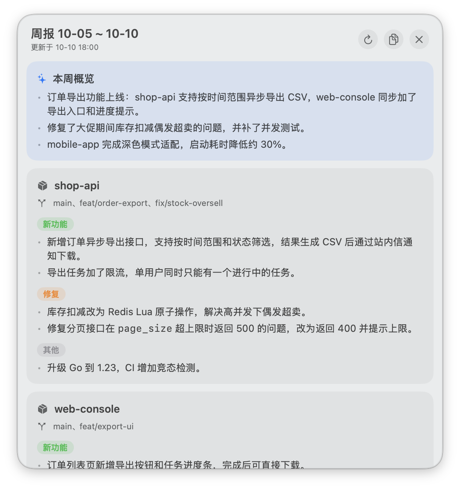

# WeeklyReport

macOS 桌面开发者卡片：一张贴在桌面上的卡片，用标签页切换几个小组件，数据都来自你本机的 git 仓库和 [Claude Code](https://claude.com/claude-code)。

| 标签 | 内容 | 刷新 |
|---|---|---|
| 周报 | 本周一以来你在各仓库的提交，由 claude 整理成周会用的周报（功能、分支、修复） | 每天 9 点、18 点 |
| 站会 | 上一个工作日到现在的提交，整理成站会发言要点 | 每天 9 点、18 点 |
| 仓库 | 按组列出有未提交改动、未推送提交或落后远端的仓库 | 每 15 分钟 |
| 用量 | Claude Code 今天和本周的 token 用量，按天、项目、模型拆分 | 每 15 分钟 |
| 待办 | ONES 上分配给你的未关闭工单，GitLab 上等你处理和你发起的合并请求 | 每 15 分钟 |
| 发布 | 各服务在每个环境的当前版本（读 GitOps 部署仓库），以及最新发布分支的流水线状态 | 每 15 分钟 |
| 工时 | 按提交里出现的 ONES 工单号估算本周每天的工时，确认后一键登记到 ONES | 每天 9 点、18 点 |

前四个只需要本机的 git 和 claude；后三个要在配置里填数据源，没填时标签页只显示一句提示。



## 依赖

- macOS 13+，Xcode Command Line Tools（`xcode-select --install`，提供 `swiftc`、`git`、`/usr/bin/python3`）
- 已登录的 `claude` 命令行

## 安装

```bash
./install.sh ~/code            # 参数是存放各仓库的目录，可以传多个
HOUR=17 ./install.sh ~/code    # 傍晚那次改到 17 点，默认 18 点
```

脚本会编译 `build/WeeklyReport.app`，并安装三个 LaunchAgent：

- `weeklyreport.generate`：每天 9 点和 18 点生成周报、站会与工时
- `weeklyreport.local`：每 15 分钟刷新仓库状态、用量、待办与发布
- `weeklyreport.app`：登录时启动桌面卡片

卡片可拖动、可拉伸，右上角三个按钮分别是立即重新生成当前标签、复制 Markdown、退出。

## 配置

`~/Library/Application Support/WeeklyReport/config.json`：

```json
{
  "roots": ["/Users/me/code"],
  "authors": [],
  "groups": {"后端": ["shop-api", "pay-service"]}
}
```

- `roots`：存放仓库的目录，扫描其下一层带 `.git` 的子目录
- `authors`：额外的提交身份（邮箱或名字）。默认已按每个仓库的 `git config user.email` 识别你的提交，只有用过别的邮箱提交时才需要填
- `groups`：可选，手动指定仓库分组（组名 → 仓库目录名）。没指定的仓库按 `origin` 地址里的命名空间自动归组，比如 `git@host:backend/shop-api.git` 归到 `backend`

### 可选数据源

```json
{
  "ones_mcp": "ones-mcp",
  "gitlab": "http://gitlab.example.com",
  "releases": {
    "deploy_project": "ops/deploy",
    "ref": "master",
    "services": [{"name": "shop-api", "path": "shop-api-k8s", "project": "backend/shop-api"}]
  }
}
```

- `ones_mcp`：你在 Claude Code 里配置的 ONES MCP 服务名（`~/.claude.json` 的 `mcpServers` 里那个名字）。待办和工时直接调用这个服务，复用它的地址和鉴权，不经过模型。`ones_ignore_states` 可覆盖"哪些状态不算待办"，默认是已完成、已拒绝、关闭、已关闭、挂起
- `gitlab`：自建 GitLab 的地址。用 git 已保存的 HTTP 凭据（`git credential`）换取临时令牌，不需要单独建 token
- `releases`：GitOps 部署仓库的位置。约定每个服务一个目录（`path`）、其下每个环境一个子目录；环境目录最近一次提交视为最近一次发布，目录里有 `SOURCE_COMMIT` 文件时取它作为版本号。`project` 是源码仓库，用来找最新的 `release-` 分支（前缀可用 `branch_prefix` 改）

工时的估算规则：每天按 8 小时算，按当天各工单的提交数占比分摊，取 0.5 小时的整数倍。只有提交说明或分支名里带 ONES 工单号的提交会被计入。估算结果只显示在卡片上，点登记按钮并确认后才会写入 ONES；已登记的条目记在本机，不会重复登记。

修改 `widgets/` 下的脚本（比如提示词）后重新执行 `./install.sh` 生效。

## 加一个小组件

每个小组件是 `widgets/` 下的一个 Python 脚本，只做一件事：把 Markdown 写到数据目录。卡片负责渲染，`# ` 是标题，每个 `## ` 是一个分块，支持 `- ` 列表、`**加粗**` 和行内代码。

1. 新建 `widgets/foo.py`，实现 `main()`，最后调用 `common.write("foo", "标题", body)`
2. 在 `main.swift` 的 `widgets` 列表里加一行
3. 在 `install.sh` 里把 `foo` 加到某个定时任务的参数里

手动运行：`python3 widgets/run.py foo`。

## 说明

- 统计本地分支和已拉取的远端分支，不含 merge 提交，不会主动 `git fetch`
- 周报和站会会把提交记录发送给 Claude 用于生成摘要；其余标签不经过模型
- 发布标签显示的是部署仓库里的期望版本，不保证集群已经跑到这一版
- 仓库状态里的"落后远端"以上次 `git fetch` 的结果为准
- 各标签内容：`~/Library/Application Support/WeeklyReport/<组件名>.md`，日志：`~/Library/Logs/WeeklyReport.log`

## 卸载

```bash
launchctl bootout gui/$UID/weeklyreport.generate
launchctl bootout gui/$UID/weeklyreport.local
launchctl bootout gui/$UID/weeklyreport.app
rm ~/Library/LaunchAgents/weeklyreport.*.plist
rm -r ~/Library/Application\ Support/WeeklyReport
```
