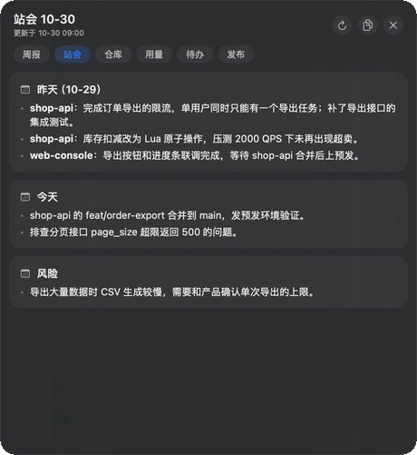

# DevCards

English | [简体中文](README.zh-CN.md)

A developer card for the macOS desktop: one card pinned to your desktop, with tabs that switch between a few small widgets. All data comes from the git repositories on your machine and [Claude Code](https://claude.com/claude-code).

> The card's interface and the generated summaries are currently in Chinese.

| Tab | What it shows | Refresh |
|---|---|---|
| Weekly | Your commits across repositories since Monday, or over a date range picked with the calendar button, written up by claude as a weekly report (features, branches, fixes) | Daily at 9:00 and 18:00 |
| Standup | Commits since the previous working day, turned into talking points for standup | Daily at 9:00 and 18:00 |
| OKR | Features shipped last month, grouped by repository, plus a draft of this month's OKRs | Daily at 9:00 and 18:00 |
| Repos | Repositories with uncommitted changes or unpushed commits, grouped | Every 15 minutes |
| Usage | Claude Code token usage today and this week, broken down by day, project and model | Every 15 minutes |
| Todo | Open issues assigned to you in ONES, and GitLab merge requests waiting on you or opened by you | Every 15 minutes |
| Releases | The current version of each service in every environment (read from a GitOps deploy repository), and the pipeline status of the latest release branch | Every 15 minutes |
| Hours | This week's hours per day, estimated from the ONES issue IDs in your commits; log them to ONES with one click after confirming | Daily at 9:00 and 18:00 |
| Upload | Drop a file on the card to upload it to a shared server disk and copy its path; lists recent files on the shared disk | On drop and on refresh |

The first five tabs need only git and claude on your machine. The last four need a data source in the config; without one, the tab just shows a hint.

[ONES](https://ones.cn) is a project management tool, connected here through its MCP server.



## Requirements

- macOS 13+, Xcode Command Line Tools (`xcode-select --install`, which provides `swiftc`, `git` and `/usr/bin/python3`)
- The `claude` CLI, logged in

## Install

```bash
./install.sh ~/code            # directories that hold your repositories; you can pass several
HOUR=17 ./install.sh ~/code    # move the evening run to 17:00 (default 18:00)
```

The script builds `build/DevCards.app` and installs three LaunchAgents:

- `devcards.generate`: generates the weekly report, standup, OKR and hours at 9:00 and 18:00 every day
- `devcards.local`: refreshes repos, usage, todo and releases every 15 minutes
- `devcards.app`: starts the desktop card at login

The card can be dragged and resized. The three buttons in the top right regenerate the current tab, copy it as Markdown, and quit; the Hours tab has an extra button to log time.

## Configuration

`~/Library/Application Support/DevCards/config.json`:

```json
{
  "roots": ["/Users/me/code"],
  "authors": [],
  "tabs": ["weekly", "standup", "repos", "usage"],
  "groups": {"backend": ["shop-api", "pay-service"]}
}
```

- `roots`: directories holding your repositories; every direct subdirectory with a `.git` is scanned
- `authors`: extra commit identities (emails or names). Your commits are already recognised by each repository's `git config user.email`; only fill this in if you have committed under other emails
- `tabs`: optional, which tabs to show and in what order, e.g. `["weekly", "standup", "repos"]`. Available names: `weekly`, `standup`, `okr`, `repos`, `usage`, `todo`, `releases`, `hours`, `upload`. All are shown if omitted
- `groups`: optional, assign repositories to groups by hand (group name → repository directory names). Repositories not listed are grouped by the namespace in their `origin` URL, e.g. `git@host:backend/shop-api.git` goes into `backend`

### Optional data sources

```json
{
  "ones_mcp": "ones-mcp",
  "gitlab": "http://gitlab.example.com",
  "releases": {
    "deploy_project": "ops/deploy",
    "ref": "master",
    "services": [{"name": "shop-api", "path": "shop-api-k8s", "project": "backend/shop-api"}]
  },
  "upload": {
    "hosts": ["me@gpu1", "me@gpu2"],
    "dir": "/shared/me/inbox"
  }
}
```

- `ones_mcp`: the name of the ONES MCP server you configured in Claude Code (the key under `mcpServers` in `~/.claude.json`). Todo and Hours call this server directly, reusing its address and auth, without going through the model. `ones_ignore_states` overrides which states don't count as todo; the default is the Chinese state names for done, rejected, closed (two variants) and on hold
- `gitlab`: the URL of your self-hosted GitLab. A temporary token is obtained from the HTTP credentials git has already saved (`git credential`), so you don't need to create a token
- `releases`: where the GitOps deploy repository is. The convention is one directory per service (`path`) with one subdirectory per environment; the latest commit in an environment directory counts as its latest release, and a `SOURCE_COMMIT` file in it, if present, is used as the version. `project` is the source repository, used to find the newest `release-` branch (change the prefix with `branch_prefix`)
- `upload`: where files dropped on the card go. `hosts` are machines that mount the same shared disk (ssh targets, passwordless), tried in order until one connects; `dir` is the directory on the shared disk, created if missing. Files land as 644 and directories as 755, so they are readable from other machines even under a different uid; a file with the same name is overwritten

How hours are estimated: each day counts as 8 hours, split by each issue's share of that day's commits and rounded to multiples of 0.5 hours. Only commits with an ONES issue ID in the message or branch name count. Estimates are only shown on the card; nothing is written to ONES until you press the log button and confirm. Logged entries are remembered locally and never logged twice.

This month's OKRs are drafted once at the start of the month and saved to `~/Library/Application Support/DevCards/okr/<year-month>.md`, which is never overwritten afterwards: edit that file to adjust the goals and the card shows your version; delete it and refresh to draft again. Last month's achievements come from commits only and are not checked against the OKRs.

After changing scripts under `widgets/` (the prompts, for example), run `./install.sh` again.

## Adding a widget

Each widget is a Python script under `widgets/` that does one thing: write Markdown to the data directory. The card renders it: `# ` is the title, each `## ` is a section, and `- ` lists, `**bold**` and inline code are supported.

1. Create `widgets/foo.py` with a `main()` that ends with `common.write("foo", "Title", body)`
2. Add a line to the `widgets` list in `main.swift`
3. Add `foo` to one of the scheduled jobs' arguments in `install.sh`

Run it by hand with `python3 widgets/run.py foo`.

`./demo.sh` opens a separate card on the sample data in `docs/demo/` (cycling through the tabs, as in the GIF above), without touching your own data.

## Notes

- Counts local branches and already-fetched remote branches, excludes merge commits, and never runs `git fetch` itself
- Weekly, Standup and OKR send your commit history to Claude to write the summaries; the other tabs don't use the model
- Releases shows the version the deploy repository asks for, not necessarily what the cluster is running yet
- "Behind remote" in Repos is as of your last `git fetch`
- Tab contents: `~/Library/Application Support/DevCards/<widget>.md`; log: `~/Library/Logs/DevCards.log`

## Uninstall

```bash
launchctl bootout gui/$UID/devcards.generate
launchctl bootout gui/$UID/devcards.local
launchctl bootout gui/$UID/devcards.app
rm ~/Library/LaunchAgents/devcards.*.plist
rm -r ~/Library/Application\ Support/DevCards
```
